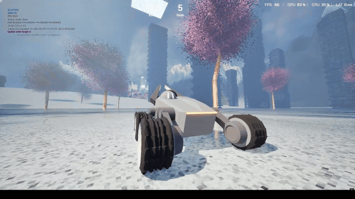
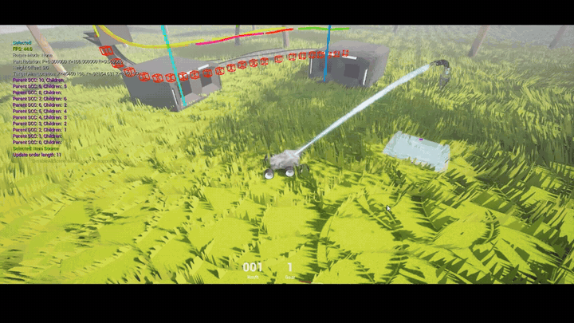
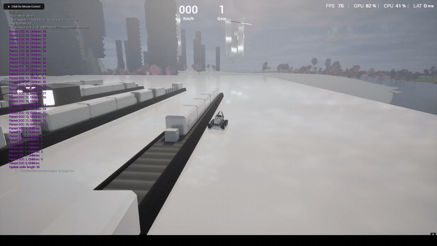
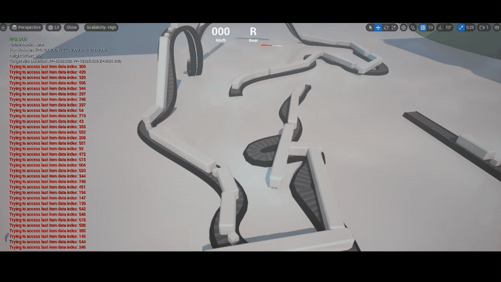
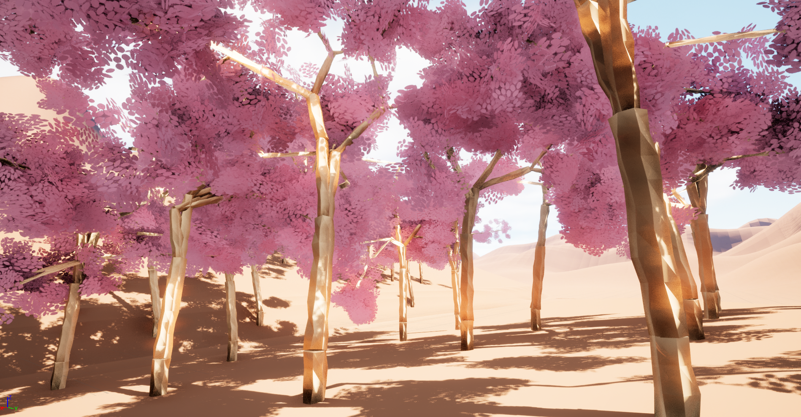
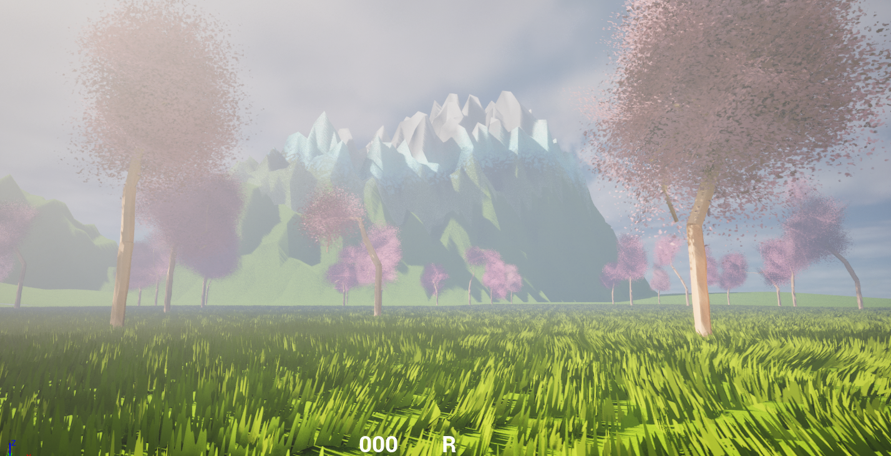
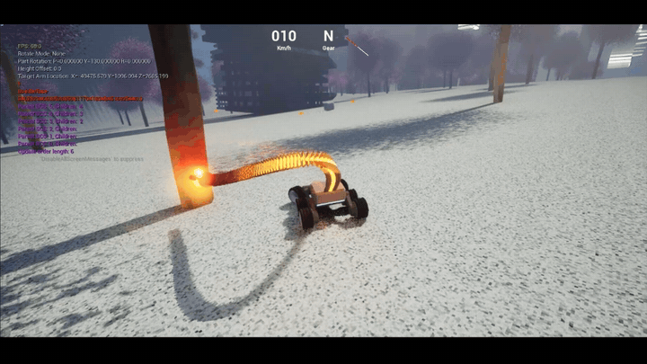
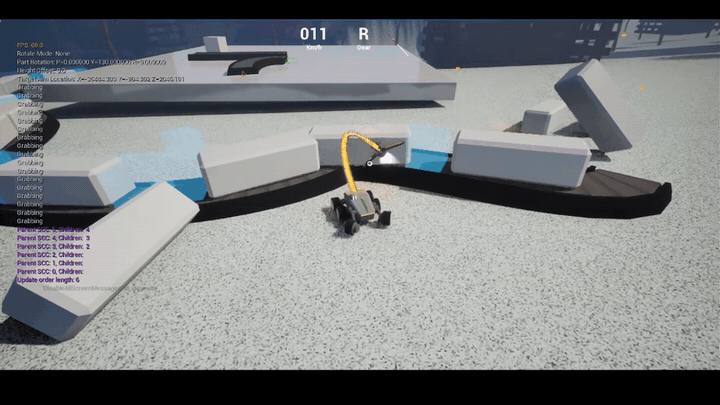

# LumberGame

A factory and forestry game built in Unreal Engine 5 with C++. Players explore a procedurally generated world, cut down trees, and build conveyor belt networks to move and process resources.

Key systems:

- **Procedural terrain** built from noise functions, Procedural Mesh Components, and material vertex colours
- **Multithreaded chunk loading** with a level-of-detail system to keep frame rates smooth
- **Procedural trees** that can be cut into pieces, each with its own physics and collision
- **Conveyor belt simulation** that uses topological sorting and Tarjan's algorithm to move items in the correct order

> **Note:** All GIFs were reduced from 60 fps to about 15 fps to keep file sizes down.

 

## Conveyor Belts

Players build conveyor belts by laying them out along a path. Each belt is made of segments, and each segment passes items on to the next one.

### Getting the update order right

Belts move items forward every frame, and the order the segments update in matters. If a segment moves its items before the segment in front of it has made room, those items cannot advance yet. The belt ends up with gaps between items that should be packed tightly.

To avoid this, segments have to update front to back: the segment at the end of a line goes first, then the one feeding into it, and so on. The conveyor network is treated as a directed graph, where each segment is a node and each connection points to the segment it feeds. A **topological sort** of this graph gives an update order in which every segment runs after the segments it feeds into.

A topological sort only works when the graph has no cycles, and players can build belts that loop back on themselves. **Tarjan's algorithm** finds these loops (the graph's strongly connected components). Each loop is grouped and updated as a single unit, and the rest of the network is sorted around it. The result is a simulation where items move smoothly with no gaps, however the belts are arranged.

 

## Procedural Terrain Generation

The terrain is built in chunks. Each chunk is a grid of points, offset vertically by sampling a noise function, and turned into geometry with a Procedural Mesh Component. Material vertex colours shade the terrain, which lets one material blend different terrain types without extra textures.

New chunks are loaded through a query-and-queue system that runs across multiple threads. Generation work stays off the game thread, so new terrain can load without noticeable lag spikes.

### Level of detail

Distant chunks are rendered at a lower resolution to save memory and GPU time. The same query-and-queue system flags a chunk for re-rendering at a higher or lower resolution as the player moves.

 

## Procedural Trees and Tree Cutting

Trees are generated with a recursive algorithm that uses a seed for randomness and builds the geometry with a Procedural Mesh Component.

Cutting uses Unreal Engine's built-in procedural mesh slicing to split a log into two separate objects, each with its own collision. Keeping the rest of the tree's structure and physics correct after a cut needed more work. Each log's information is stored in a data structure, and recursive functions update how the remaining pieces connect.

 

## Early Development

Earlier footage from the project's development.

 

## Credits and AI Use

- The vehicle model was not made by me.
- No AI-generated code or assets were used in this project. The only AI assistance was in identifying which algorithms could fix the conveyor belt update-order problem described above, which led to using topological sorting and Tarjan's algorithm. The implementation is my own.
